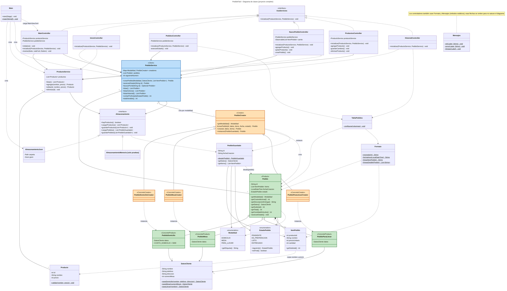
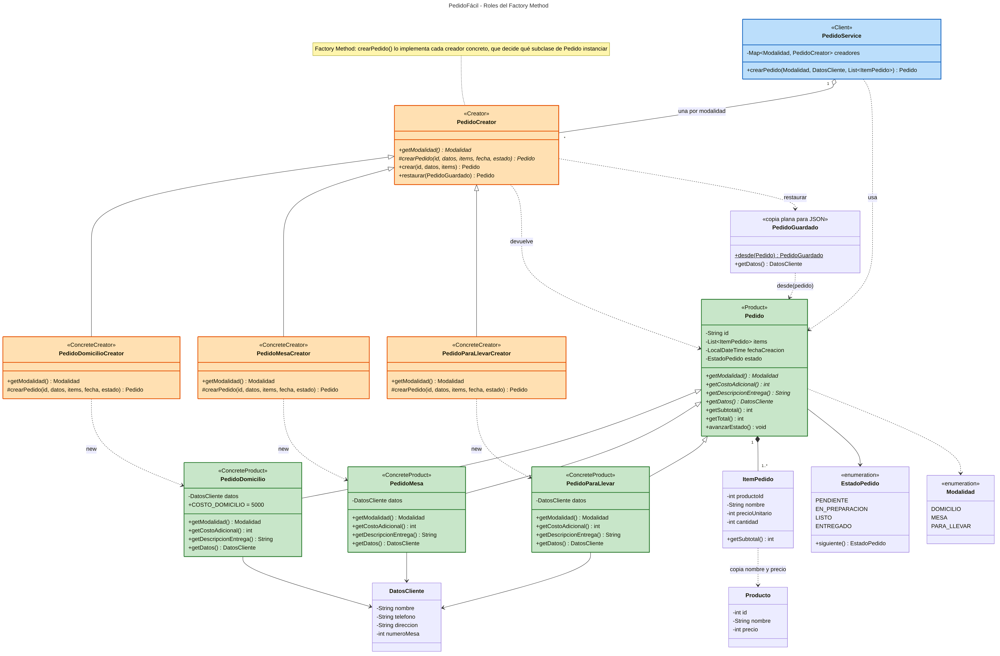
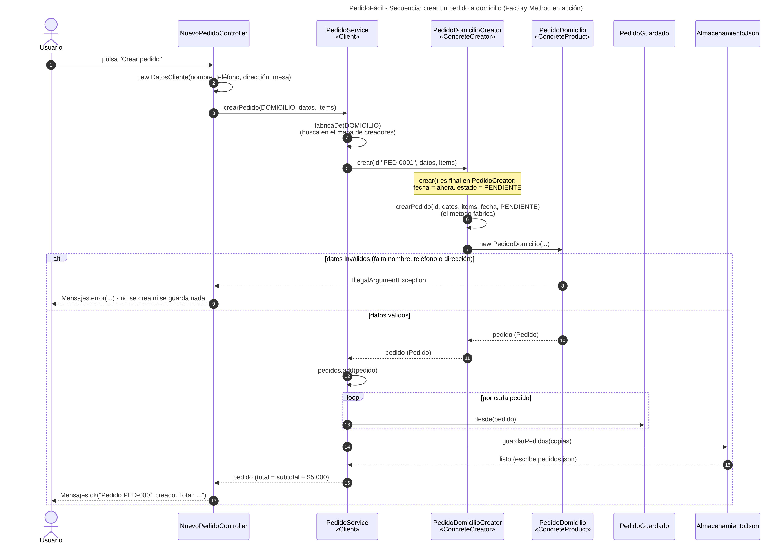

# PedidoFácil

Aplicación de escritorio para gestionar los pedidos de una tienda de barrio o un restaurante pequeño:
crear pedidos (a domicilio, en mesa o para llevar), seguirlos por estados, administrar el menú de
productos y consultar el historial de lo entregado.

**Tecnologías:** Java 17+ (probado con JDK 21), JavaFX 21, FXML, CSS, Maven, JUnit 5 y Gson.

## Cómo ejecutarlo

Desde la carpeta del proyecto (donde está `pom.xml`):

```
mvn test            # corre las pruebas automáticas
mvn javafx:run      # abre la aplicación
```

- Los datos se guardan en la carpeta `data/` (se crea sola): `productos.json` y `pedidos.json`.
- La primera vez se cargan 8 productos de ejemplo; después se usan los que haya en `productos.json`.
- Si un JSON está dañado, la aplicación avisa y se cierra sin tocar el archivo.

## Qué hace

| Pantalla | Función |
|---|---|
| Inicio | Resumen: pedidos por estado, total vendido y número de productos. |
| Nuevo pedido | Elegir modalidad, escribir los datos que esa modalidad pide, agregar productos y ver el total. |
| Pedidos | Lista de pedidos activos; avanzar el estado un paso a la vez. |
| Productos | Agregar, editar y eliminar productos del menú. |
| Historial | Pedidos ya entregados. |

## Reglas del negocio

- **Modalidades y datos obligatorios:** domicilio (nombre, teléfono y dirección), mesa (número mayor que cero) y para llevar (nombre).
- **Costo de domicilio:** fijo, $5.000. Mesa y para llevar no cobran extra.
- **Estados:** `PENDIENTE → EN_PREPARACION → LISTO → ENTREGADO`. Solo avanzan un paso; no se cancela ni se retrocede.
- **Ids:** secuenciales, `PED-0001`, `PED-0002`…
- **Precios:** pesos enteros (`int`), sin decimales.
- **Pedidos antiguos:** cada item guarda su propio nombre y precio, así cambiar o borrar un producto no altera pedidos ya hechos.

## Estructura del código

```
src/main/java/pedidofacil/
├── app/          Main (arranque; crea los servicios una sola vez)
├── models/       Pedido (abstracta), PedidoDomicilio, PedidoMesa, PedidoParaLlevar,
│                 ItemPedido, Producto, DatosCliente, PedidoGuardado, Modalidad y EstadoPedido (enums)
├── factories/    PedidoCreator (abstracta) y sus tres creadores concretos
├── services/     PedidoService, ProductoService, Almacenamiento (interfaz), AlmacenamientoJson
├── controllers/  un controlador por pantalla, más UsaServicios y TablaPedidos
└── util/         Formato (dinero y fechas) y Mensajes (avisos en pantalla)
src/main/resources/
├── views/        MainView, InicioView, PedidosView, NuevoPedidoView, ProductosView, HistorialView (.fxml)
└── styles/       estilos.css
src/test/java/    pruebas JUnit 5 (ver "Pruebas")
uml/              diagramas UML (.png = imagen, .mmd = fuente Mermaid)
docs/             resultados de las pruebas y prueba de extensión
```

Decisiones de diseño:

- **Un solo patrón: Factory Method.** Los estados son un `enum` (no hay patrón State), no hay Singleton y no hay `module-info.java`.
- **Sin Singleton:** `Main` crea los servicios y cada controlador los recibe con `UsaServicios.inicializar(...)` justo después de cargar su FXML. Por eso los controladores tienen constructor vacío y se pueden abrir en Scene Builder.
- **Almacenamiento intercambiable:** los servicios dependen de la interfaz `Almacenamiento`. `AlmacenamientoJson` usa archivos; las pruebas usan una versión en memoria.
- **JSON plano:** se guarda una copia plana del pedido (`PedidoGuardado`); al cargar, las fábricas reconstruyen el pedido real.
- **Escritura segura:** el JSON se escribe primero en un archivo `.tmp` y luego reemplaza al original.

## Patrón Factory Method

`PedidoCreator` declara el método fábrica `crearPedido(...)`; cada creador concreto decide qué subclase de `Pedido` instanciar.
El patrón está en el flujo principal: al pulsar "Crear pedido", `NuevoPedidoController` llama a `PedidoService.crearPedido(...)`, y este usa la fábrica de la modalidad elegida.

| Rol | Clase | Dónde verlo en el código |
|---|---|---|
| Creator (abstracto) | `PedidoCreator` | `factories/PedidoCreator.java`: método fábrica abstracto `crearPedido` (línea 26); `crear` (línea 30) y `restaurar` (línea 36) son `final` y lo llaman |
| ConcreteCreator | `PedidoDomicilioCreator`, `PedidoMesaCreator`, `PedidoParaLlevarCreator` | `factories/`: `crearPedido` (línea 22) hace `new PedidoDomicilio(...)`, `new PedidoMesa(...)` o `new PedidoParaLlevar(...)` (línea 24) |
| Product (abstracto) | `Pedido` | `models/Pedido.java`: costo adicional, descripción de entrega y datos son métodos abstractos |
| ConcreteProduct | `PedidoDomicilio`, `PedidoMesa`, `PedidoParaLlevar` | `models/` |
| Client | `PedidoService` | `services/PedidoService.java`: `fabricaDe(modalidad)` y `fabrica.crear(...)` (líneas 56-57); al cargar, `restaurar(...)` (línea 48) |
| Punto de entrada en la interfaz | `NuevoPedidoController` | `controllers/NuevoPedidoController.java`, línea 145: `pedidoService.crearPedido(...)` |

`PedidoService` guarda un mapa `Modalidad → PedidoCreator` y no conoce las clases concretas de pedido.

## Diagramas UML

En la carpeta `uml/` (imagen `.png` y fuente `.mmd` de cada uno):

1. **`diagrama-clases`**: todas las clases del proyecto, con atributos, métodos principales, relaciones y multiplicidades. Los roles del patrón van con estereotipo y color: naranja = Creator / ConcreteCreator, verde = Product / ConcreteProduct, azul = Client.
2. **`diagrama-patron`**: detalle del Factory Method, con los métodos que sobrescribe cada clase concreta.
3. **`diagrama-secuencia`**: crear un pedido a domicilio, de la pantalla al archivo JSON, incluido el caso de datos inválidos.







El diagrama de clases omite las flechas de los controladores hacia `Formato` y `Mensajes` (métodos estáticos) y no incluye las clases de prueba, salvo `AlmacenamientoMemoria`. Los diagramas se comprobaron contra el código: las 29 clases e interfaces de `src/main` aparecen en el diagrama completo. Si se cambia el código, hay que actualizarlos a mano.

## Pruebas

Hay 81 pruebas JUnit 5 (modelos, fábricas, servicios, almacenamiento con archivos reales y formato). No hay pruebas automáticas de la interfaz JavaFX; esa parte se probó a mano con `mvn javafx:run`.

**`mvn test` en un entorno real: `Tests run: 81, Failures: 0, Errors: 0, Skipped: 0`, `BUILD SUCCESS`.** Detalle por clase, salida completa y qué se verificó y qué no: [`docs/resultados-pruebas.md`](docs/resultados-pruebas.md).

## Prueba de extensión: pedido programado

Se agregó una cuarta modalidad, el **pedido programado** (se recoge en el local a una hora acordada), en una copia del proyecto. **Clases existentes modificadas: 6** (`Modalidad`, `PedidoService`, `DatosCliente`, `PedidoGuardado`, `NuevoPedidoController` y `NuevoPedidoView.fxml`); **clases nuevas: 2** (`PedidoProgramado` y `PedidoProgramadoCreator`). Solo 2 de las 6 modificaciones (`Modalidad` y `PedidoService`) corresponden al patrón; las otras 4 se deben a que la modalidad necesita un dato nuevo, la hora. `PedidoCreator`, los demás creadores y los demás pedidos no cambiaron, y las 80 pruebas anteriores pasaron sin tocarlas.

Detalle, hallazgos y lo que no se pudo verificar: [`docs/prueba-extension.md`](docs/prueba-extension.md).

## Video

Enlace al video: **(pendiente: pegar aquí el enlace)**
